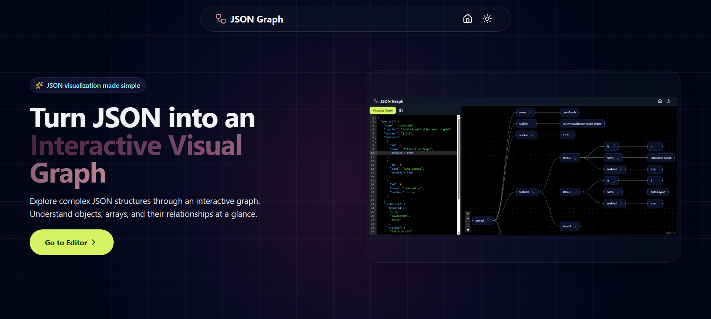
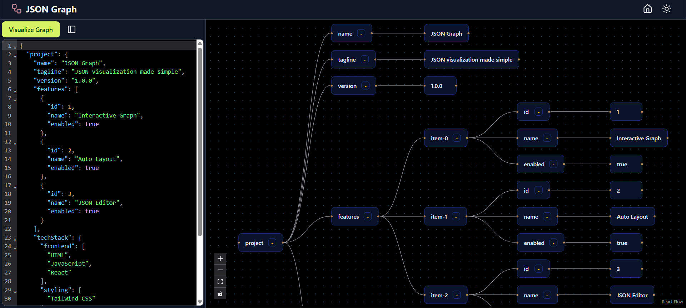

<div align="center">

# JSON Graph

### Visualize JSON. Understand structure. Explore relationships.

Transform complex, nested JSON data into an interactive graph.
Explore objects, arrays, and connections through a clean visual interface.

<br />

[](https://graph-json.vercel.app/)
[](https://github.com/CodeAryann/JSON-Graph)
<br />

</div>

---

## ✦ Overview

JSON Graph is an interactive visualization tool designed to make complex JSON structures easier to understand. By transforming raw data into a graph of connected nodes, it allows you to explore objects, arrays, and their relationships in a visual format, simplifying data inspection and structural analysis.

## ✨ Features

<table>
  <tr>
    <td width="50%">
      <strong>◈ Interactive Visualization</strong><br />
      Explore JSON objects, values, arrays, and their relationships as connected nodes.
    </td>
    <td width="50%">
      <strong>⤢ Automatic Layout</strong><br />
      Organize graph nodes from left to right for a clear, readable structure.
    </td>
  </tr>
  <tr>
    <td width="50%">
      <strong>⌘ Expand & Collapse</strong><br />
      Navigate nested structures interactively without losing context.
    </td>
    <td width="50%">
      <strong>⌨ JSON Editor</strong><br />
      Write, paste, and edit JSON directly inside the application.
    </td>
  </tr>
  <tr>
    <td width="50%">
      <strong>◐ Light & Dark Themes</strong><br />
      Switch between themes for a comfortable viewing experience.
    </td>
    <td width="50%">
      <strong>⊹ Graph Navigation</strong><br />
      Navigate larger graphs with canvas controls and a minimap.
    </td>
  </tr>
</table>

## 📸 Screenshots

<div align="center">

### Home Page



### JSON Graph Editor & Visualization



</div>

## 🧰 Tech Stack

<div align="center">

| Frontend | Visualization | Tooling & Deployment |
|:---:|:---:|:---:|
|  |  |  |
|  |  |  |
|  |  |  |
| |  | |

</div>

## 🚀 Getting Started

### Prerequisites

- [Node.js](https://nodejs.org/)
- npm
- Git

### Installation

**1. Clone the repository**

```bash
git clone https://github.com/CodeAryann/JSON-Graph.git
```

**2. Navigate to the project**

```bash
cd JSON-Graph
```

**3. Install dependencies**

```bash
npm install
```

**4. Start the development server**

```bash
npm run dev
```

Open the local URL displayed in your terminal.

## 📜 Scripts

| Command | Description |
|:---|:---|
| `npm run dev` | Start the development server |
| `npm run build` | Build the application for production |
| `npm run preview` | Preview the production build locally |

## 📂 Project Structure

```text
JSON-Graph/
├── public/
│   └── workflow.svg
├── src/
│   ├── components/
│   │   ├── GraphCanvas.jsx
│   │   ├── GraphNode.jsx
│   │   ├── JsonEditor.jsx
│   │   └── Navbar.jsx
│   ├── pages/
│   │   ├── Home.jsx
│   │   └── Editor.jsx
│   ├── utils/
│   │   ├── jsonToGraph.js
│   │   └── layoutGraph.js
│   ├── App.jsx
│   ├── index.css
│   └── main.jsx
├── package.json
└── vite.config.js
```

---

## 👨🏻‍💻 Author

<div align="center">

### Aryan Sahu

*Developer · Creator of JSON Graph*

[](https://github.com/CodeAryann)

<br />

If you find this project useful, consider giving it a ⭐

**Built with React**

</div>
